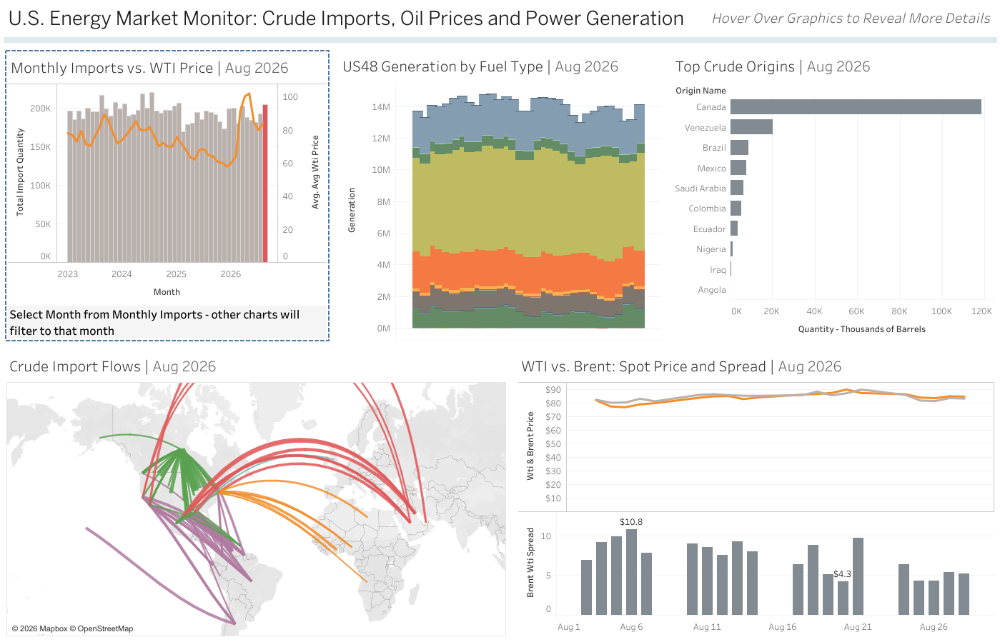
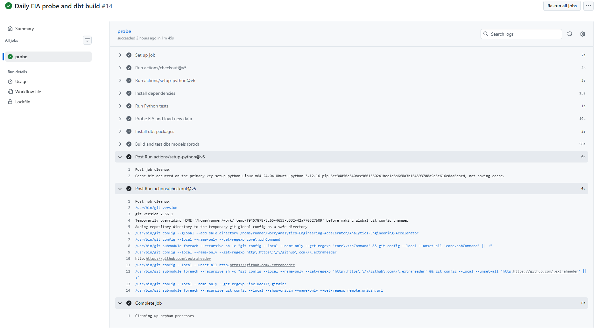
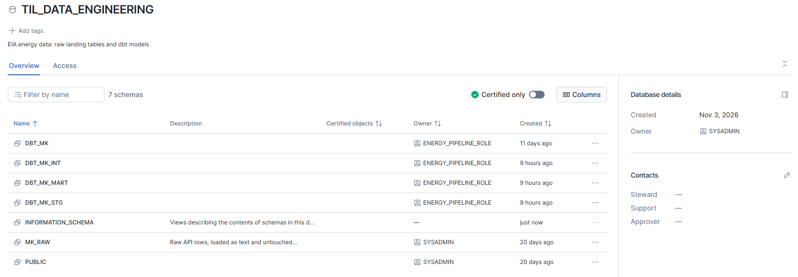
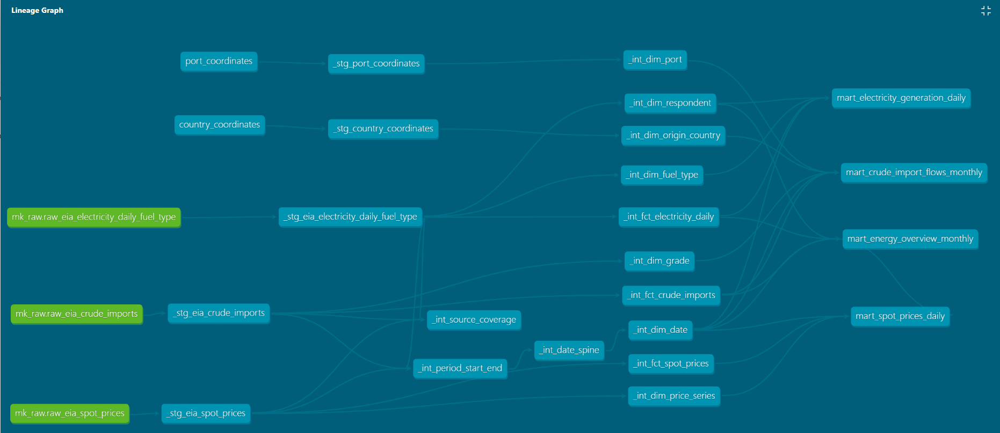

# U.S. Energy Market Monitor: EIA API to Snowflake to dbt to Tableau

A daily-refreshing analytics pipeline. It pulls U.S. energy data from the EIA open data API, lands it unchanged in Snowflake, models it into a star schema and marts with dbt, and feeds a Tableau Public dashboard. A GitHub Actions workflow runs the load and the dbt build every day.

[](https://public.tableau.com/app/profile/matthew.kelleher3499/viz/USEnergyMarketMonitor/USEngergyMarketMonitor)

*Click the image for the live dashboard on Tableau Public. It is a snapshot of an extract taken on 2026-11-23 and does not refresh on its own (see [Dashboard](#dashboard)).*

Data: [U.S. Energy Information Administration (EIA) open data API v2](https://www.eia.gov/opendata/).

## Contents

1. [The core ask and the extras](#1-the-core-ask-and-the-extras)
2. [How it works](#2-how-it-works)
3. [Quick start](#3-quick-start)
4. [Data sources and ingestion](#4-data-sources-and-ingestion)
5. [Data model](#5-data-model)
6. [Testing](#6-testing)
7. [Automation](#7-automation)
8. [Assumptions and design choices](#8-assumptions-and-design-choices)
9. [Differences from the brief](#9-differences-from-the-brief)
10. [Known limitations](#10-known-limitations)
11. [What I would do next](#11-what-i-would-do-next)
12. [Repo layout](#12-repo-layout)

---

## 1. The core ask and the extras

**The core ask is met.** The brief wants a free API with a daily time series, an ingestion job that brings in new data every day, a star schema, and one dashboard-ready mart. I met it with the EIA route `electricity/rto/daily-fuel-type-data`, the one source I found that genuinely refreshes daily. The core path, end to end:

1. Python ingestion of that route, run by the daily GitHub Actions workflow, into `MK_RAW.RAW_EIA_ELECTRICITY_DAILY_FUEL_TYPE`.
2. Staging: `_stg_eia_electricity_daily_fuel_type`.
3. Star schema: `_int_fct_electricity_daily` with `_int_dim_date`, `_int_dim_respondent` and `_int_dim_fuel_type`.
4. The dashboard-ready mart at daily grain: `TIL_DATA_ENGINEERING.DBT_MK_MART.MART_ELECTRICITY_GENERATION_DAILY` (one row per day, respondent and fuel type).

**The extras are deliberate.** On top of the core I set myself a harder problem: sources with different grains. I added crude oil imports (monthly, by origin country, port and grade), WTI and Brent spot prices (daily rows that arrive in weekly batches), two geographic seed files, three more marts and a Tableau dashboard. They show how to join sources of different grains, aggregate before joining so one source does not multiply another, use dbt seeds for reference data, and fix real data problems (FIPS vs ISO country codes, repeated levels in the API, inconsistent names). The extras refresh on their own schedules (crude monthly, prices weekly), so they do not bring in new data every day. The core does.

## 2. How it works

```
EIA API v2
   |  Python client: pages of 5,000 rows, retries with backoff
   v
Daily probe (ingestion/probe.py): asks each route for its newest row,
loads only when something is newer, merges on the natural key
   |
   v
MK_RAW            raw rows unchanged (VARIANT) + key columns, row hash, batch id, load time
   |              every run logged in MK_RAW.PIPELINE_RUN_LOG
   v
staging (stg)     typed, renamed, dates parsed                      7 objects
   v
intermediate (int) star schema (dims, facts) and helper models      13 objects
   v
marts (mart)      one mart per question, each at its own grain      4 objects
   v
Tableau Public    reads the four marts
```

One GitHub Actions workflow (`.github/workflows/daily_probe.yml`) runs every day: Python tests, the probe, `dbt deps`, then `dbt build --target prod`. The probe asks EIA for the newest period of each source and loads a source only if it has data newer than what Snowflake holds. A load re-reads a short trailing window and merges on the natural key, so running it twice inserts nothing new.

## 3. Quick start

**Environment.** The project is built to run in GitHub Codespaces from the dev container in `.devcontainer/` (base image `mcr.microsoft.com/devcontainers/python:3.12-bookworm`). Open the repo in a Codespace and the post-create step installs `requirements.txt` and prints the Python and dbt versions. Versions are pinned: dbt Core 1.12.6, dbt-snowflake 1.12.4, plus pins for `python-dotenv`, `requests`, `snowflake-connector-python` and `pytest`. The dev container also lists the VS Code extensions I used for Python, dbt and Snowflake work.

**Credentials.** Set four secrets (Codespaces secrets for development, repository secrets for GitHub Actions; the two stores are separate):

| Name | Used for |
|---|---|
| `EIA_API_KEY` | EIA API key (free, from eia.gov/opendata) |
| `SNOWFLAKE_ACCOUNT` | Snowflake account identifier |
| `SNOWFLAKE_USER` | Snowflake user |
| `SNOWFLAKE_PASSWORD` | Snowflake password |

`.env.example` shows the same names for a local `.env`. Role, warehouse, database and schema names are not secrets and sit in `dbt_project/profiles.yml` and `.env.example`. `profiles.yml` reads the three Snowflake values with `env_var()`, so no credentials are in the repo.

**Snowflake objects the pipeline expects.** I created these once in my own trial account:

| Object | Name |
|---|---|
| Database | `TIL_DATA_ENGINEERING` |
| Role | `ENERGY_PIPELINE_ROLE` (the pipeline does not run as `ACCOUNTADMIN`) |
| Warehouse | `ENERGY_WH` (X-Small, suspends after 60 seconds) |
| Raw schema | `MK_RAW` |
| dbt dev schema | `dbt_mk` |
| dbt prod schemas | `dbt_mk_stg`, `dbt_mk_int`, `dbt_mk_mart` |

**Run it** (from the repo root unless noted):

```bash
pip install -r requirements.txt            # done by the dev container already
python -m pytest tests                      # offline tests, no network, no Snowflake

python ingestion/probe.py --dry-run         # decide only: no loads, no run-log rows
python ingestion/probe.py                   # load every source that has newer data

cd dbt_project
dbt deps                                    # installs dbt_utils
dbt build                                   # dev target: everything into dbt_mk
dbt build --target prod                     # prod target: dbt_mk_stg, dbt_mk_int, dbt_mk_mart
```

`dbt build` runs seeds, models and tests in dependency order and skips everything downstream of a failed test. If you prefer the two steps separately, `dbt run` followed by `dbt test` does the same work. The default target is `dev`; Tableau reads `dbt_mk_mart`, which only the prod target fills.

**Dev to prod.** I develop and test on the dev target (`dbt_mk`), then promote with `--target prod`. The scheduled workflow runs prod. Both targets read the same `MK_RAW` tables, so they differ only in the version of the code they run. `dbt_mk` stays as the record of the development work.

Other probe options: `--source NAME` probes one source (`crude_imports`, `spot_prices` or `electricity`, repeatable) and `--force` loads even when EIA has nothing newer. Each source also has its own entry point (`ingestion/load_crude_imports.py`, `load_spot_prices.py`, `load_electricity.py`) with `--dry-run`, `--full`, `--start` and `--window` options defined in `ingestion/loader.py`.

## 4. Data sources and ingestion

### Sources

All three come from one provider, the EIA API v2, through one client and one key. One authentication method and one response shape kept the client simple, while the routes still arrive on different schedules.

| Source | Route | Frequency | Selection | Raw table in `MK_RAW` | Role |
|---|---|---|---|---|---|
| Electricity generation by fuel type | `electricity/rto/daily-fuel-type-data` | Daily | `US48` (reference series) plus `ERCO`, `CISO`, `PJM`, `MISO`, `NYIS`, `ISNE`; Eastern time; all fuel types; 163,029 rows when I selected it | `RAW_EIA_ELECTRICITY_DAILY_FUEL_TYPE` | **Core** |
| Crude oil imports | `crude-oil-imports` | Monthly | Origin level `CTY` (country), destination level `PT` (port); thousand barrels; loaded from 2009-01 | `RAW_EIA_CRUDE_IMPORTS` | Extra |
| WTI and Brent spot prices | `petroleum/pri/spt` | Daily rows, arriving in weekly batches | Series `RWTC` (WTI) and `RBRTE` (Brent); dollars per barrel; no weekend rows | `RAW_EIA_SPOT_PRICES` | Extra |

The filters live in `ingestion/sources.py`, so changing one means editing that file, not the loading code. I explored each route with throwaway scripts first; see [`exploration/`](#12-repo-layout).

### Why these filters

The raw API repeats the same numbers, so loading it as it comes would overcount:

- **Electricity** repeats every respondent, fuel and day once per timezone, with different values because each timezone draws the day boundary differently (5,766,693 rows unfiltered). I chose Eastern for every respondent so days line up.
- **Crude imports** repeat the same quantity at seven destination levels and four origin levels. For August 2026 with country origins, all seven destination levels sum to the same 204,420 thousand barrels, so summing the table as delivered would overcount up to sevenfold. I load one level of each.
- **Spot prices**: the route also carries nine refined-product series priced per gallon. I load only the two crude benchmarks, both in dollars per barrel.
- **Monthly, never monthly plus annual**: an annual value is the sum of its months, so I load monthly and build annual figures in dbt.

### How a load works

1. **Probe.** For each source the probe asks EIA for its newest row (one small call), compares it with the newest period in Snowflake and decides: `initial_load`, `load`, `forced_load`, `skip` or `no_data_at_source`. Forecast rows are excluded.
2. **Fetch.** The client pages 5,000 rows at a time with a stable sort, pauses between calls, and retries rate-limit (429) and connection errors with backoff. The API key is read from the environment and never printed, including in error messages.
3. **Window.** A load starts from the newest loaded period minus a trailing window, to pick up late revisions: 3 months for crude imports, 14 days for spot prices and electricity. On an empty table the first load starts at the source's first period.
4. **Check.** Every row must carry its natural key fields, and no two rows may share a key. The keys are: crude imports (period, origin, destination, grade), spot prices (period, series), electricity (period, respondent, fuel type, timezone).
5. **Merge.** Rows are merged into the raw table on the natural key and updated only when the row hash changes, so a re-run is idempotent.
6. **Log.** Every decision, including "nothing new", is written to `MK_RAW.PIPELINE_RUN_LOG` (route, newest period found, newest period held, rows loaded, status). `--dry-run` writes nothing.

### Raw layout

Each raw row is stored unchanged in one `VARIANT` column (`RAW_ROW`). The natural key columns are copied out as text beside a row hash, a batch id and a load timestamp. All casting, renaming and date parsing happens in dbt staging. This keeps the raw layer replayable without calling the API again, at the cost of wide tables and more work in staging.

### Error handling

Each source runs in its own try/except, so one failure does not stop the others. The probe exits non-zero if any source fails, which fails the workflow run. The API sometimes reports more crude rows than it returns (39,867 reported against 38,286 returned over the full history). The crude source is marked to tolerate that shortfall and reports the gap in the run summary; the other sources fail on a shortfall.

## 5. Data model

### Layers and schemas

| Layer | dbt folder | Dev schema | Prod schema | Contents |
|---|---|---|---|---|
| Raw | (loaded by Python) | `MK_RAW` | `MK_RAW` | 3 raw tables and the run log |
| Staging | `models/staging` | `dbt_mk` | `dbt_mk_stg` | 3 EIA views, 2 seed views, 2 seeds (7 objects) |
| Intermediate | `models/intermediate` | `dbt_mk` | `dbt_mk_int` | 7 dimensions, 3 facts, 3 helper models (13 objects) |
| Marts | `models/marts` | `dbt_mk` | `dbt_mk_mart` | 4 marts |

A target-aware `generate_schema_name` macro (`dbt_project/macros/`) puts everything in `dbt_mk` on dev and adds the folder suffix on prod. I put the star schema in the intermediate layer because the brief allows it and only the marts are meant for analysts and BI tools.

### Star schema and the grain of each fact

I used natural keys: EIA ids are stable, and they avoid a hashing step that would need explaining. The cost is that natural keys keep no history, so a renamed id in EIA's data would overwrite the old one.

| Fact | Grain | Measure | Why this grain |
|---|---|---|---|
| `_int_fct_electricity_daily` (core) | One row per day, respondent and fuel type (Eastern time) | Generation value | Day is the finest grain the route offers. Respondent and fuel type are kept so a mart can show the fuel mix by operator. One timezone makes days comparable across respondents, though it is not each respondent's own local day. |
| `_int_fct_crude_imports` (extra) | One row per month, origin country, port and grade | Quantity, thousand barrels | Month is the finest frequency of the route. Country is the finest origin level and port the finest level of the port branch, so state or PADD can be rolled up later without losing anything. The cost is a larger table (149 rows for one month of country origins at port level, against 40 at the `US` level). |
| `_int_fct_spot_prices` (extra) | One row per day and price series (`RWTC`, `RBRTE`) | Price, $/BBL | Day is the finest grain. Each fact sits at the finest grain its source gives, so every mart can roll up from it. |

**Dimensions:** `_int_dim_date` (day grain, built with `dbt_utils.date_spine`, with a `month_start` column so the monthly fact joins on the first-of-month row), `_int_dim_origin_country`, `_int_dim_port`, `_int_dim_grade`, `_int_dim_price_series`, `_int_dim_respondent` (`US48` flagged as a reference series) and `_int_dim_fuel_type` (one name per id, newest name wins). **Helper models:** `_int_date_spine`, `_int_period_start_end` and `_int_source_coverage`, a view of each source's newest period and lag.

Only `_int_dim_date` is shared by all three facts. Oil origins and ports have nothing in common with grid respondents, so combined marts join on date, and any mart that includes imports is monthly.

### Marts

Each mart answers one question at its own grain. All calculations (spread, monthly averages, roll-ups) are done in dbt, not in the BI tool.

| Mart | Grain | Role | Used for |
|---|---|---|---|
| `mart_electricity_generation_daily` | Day, respondent, fuel type | **Core** | Fuel mix |
| `mart_crude_import_flows_monthly` | Month, origin, port, grade (coordinates on the row) | Extra | Flow map, top origins |
| `mart_spot_prices_daily` | Day (WTI, Brent, spread) | Extra | Price lines and spread |
| `mart_energy_overview_monthly` | Month (imports, average prices, US48 generation, `is_complete_month`) | Extra, combines grains | Monthly overview |

The overview aggregates each source to the month **before** joining, so one source cannot multiply another. It uses only `US48` for electricity, and leaves a source's columns null for a month with no data, so "no data" never reads as zero.

### Seeds

| Seed | Rows | Notes |
|---|---|---|
| `country_coordinates` | 62 | EIA country codes are FIPS, not ISO. About 16 collide with different ISO codes (`CD` is Chad in FIPS but the Democratic Republic of the Congo in ISO; `GB` is Gabon, not the United Kingdom), so I built a crosswalk from the GeoNames `countryInfo.txt` file. 61 of 62 origins matched; `UNKNW` is kept with `is_known` false. |
| `port_coordinates` | 119 | BTS port codes for land crossings, Census Gazetteer name matches for most others, 10 entered by hand. A `coordinate_basis` column records where each point came from. |

## 6. Testing

- **99 dbt data tests, all passing.** The production build passes 123 of 123 (models, seeds and tests).
- **Error severity** for keys and grain: `not_null` and `unique` on every dimension key, a unique combination on every fact and staging grain, `relationships` from each fact to its dimensions, and equal row counts between each raw table (or seed) and its staging view.
- **Warn severity** for known data quirks: a port or origin missing from its seed, a negative crude quantity, a spot price dated on a weekend, a time zone other than Eastern, and stale data (newest period older than 125 days for crude imports, 14 for spot prices, 7 for electricity).
- **Why two severities:** `dbt build` skips everything downstream of a failed test, so an error is for data that is wrong and a warning is for something the data really does. The crude threshold is 125 days because EIA publishes about two months late and the period is the first day of the month; my first threshold of 100 days warned on normal data.
- **No "price greater than zero" test**, because WTI went negative in April 2020.
- **Python tests** (`tests/test_ingestion.py`, `tests/test_probe.py`) run offline with a fake EIA session and a fake Snowflake connection. They cover paging, retries, key handling, window calculation, key validation, the merge SQL, the probe's decision logic and run context.
- **Not written yet:** unit tests for the calculations (Brent-WTI spread, monthly price average, fuel-name pick).

## 7. Automation

`.github/workflows/daily_probe.yml` ("Daily EIA probe and dbt build") runs at 17:17 UTC every day and can be started by hand from the Actions tab. One job, in order:

1. Check out the repo and set up Python 3.12.
2. Install `requirements.txt` and run the Python tests.
3. Run `ingestion/probe.py`.
4. Run `dbt deps`.
5. Run `dbt build --target prod`.

Secrets are the four listed in [Quick start](#3-quick-start); `profiles.yml` reads the Snowflake ones with `env_var()`. A single concurrency group queues runs rather than cancelling one that is loading. The manual run #14 passed every step in 1 minute 45 seconds.



**On failure:** the probe exits non-zero when any source fails, so the run fails and the dbt steps are skipped, even for sources that loaded. GitHub can email failed runs if Actions notifications are on in the account settings. GitHub may delay scheduled runs, and may disable them on a public repo after a period without activity; the manual trigger covers that. The dbt build runs every day even when nothing new arrived.

**Snowflake after the first production build:**



**dbt lineage, from raw sources to the four marts:**



## 8. Assumptions and design choices

The full log is in my design decisions document; these are the ones that shape the project.

- **A daily probe counts as a daily refresh.** The API has no last-updated field and the sources publish on different schedules, so the job runs daily and loads only when a source has something newer.
- **One timezone, one level, one unit per fact.** Eastern for electricity, country and port for crude, dollars per barrel for prices (see [Why these filters](#why-these-filters)).
- **`US48` is a reference series.** It overlaps the six operators (they were about 57% of it on the latest day I checked), so the models never sum across respondents. The electricity mart carries all seven series, and the overview uses `US48` only.
- **One fuel name per id.** Four fuel ids (`BAT`, `PS`, `SNB`, `UES`) each arrive with two names. The dimension takes the name from the most recent period, and a unique test guards against two names on the latest day.
- **Raw is kept as it arrives; typing happens in staging.** Every value arrives as text and the period format changes with frequency.
- **Reload window.** Revisions are caught by re-reading 3 months (crude) or 14 days (prices and electricity) on each load. I chose these as a starting point and have not yet measured how far back EIA actually revises.
- **Tests: errors for keys and grain, warnings for quirks** (see [Testing](#6-testing)).
- **Source lag is measured, not tested.** `_int_source_coverage` reports each source's newest period, because a test would fail on normal publishing delays. On 2026-11-23: crude imports 2026-08-01 (114 days), spot prices 2026-11-17 (6 days), electricity 2026-11-21 (2 days).
- **Natural gas was evaluated and left out.** The one useful route arrives in weekly batches and adds neither a daily source nor much analysis beyond oil prices and electricity. Refined product imports were also left out; crude detail is already in `crude-oil-imports`.
- **Personal dev tooling is not part of the pipeline.** The pipeline needs only what is in `requirements.txt` and `.devcontainer/`.

## 9. Differences from the brief

| Brief | What I built | Why |
|---|---|---|
| Company Snowflake instance | Personal Snowflake trial with the same database and schema names (`TIL_DATA_ENGINEERING`, `mk` prefix), so a move changes only account details | I could not reach the company instance because of authentication |
| A single final mart table | One **core** mart, `mart_electricity_generation_daily`, plus three extra marts (crude flows, spot prices, monthly overview) | I chose to bring in sources with different grains, and each question gets a mart at its own grain |
| Data refreshing daily | The workflow runs every day. Electricity, the core source, advances almost daily. Crude imports refresh monthly and spot prices weekly. A source loads only when it has a newer period | The API has no last-updated field and sources publish on different schedules. To confirm with the brief's author that this counts |
| Star schema as staging and intermediate models | Facts and dimensions sit in the intermediate layer (`_int_dim_*`, `_int_fct_*`); marts stay for analysts | The brief allows it |
| Dashboard not assessed | Built anyway, in Tableau Public | To check the marts work without joins or calculations in the BI tool |

## 10. Known limitations

1. **Revision gap.** The probe reloads only when EIA has a newer latest period. If EIA corrects an older figure on a day with nothing new, nothing reloads it until the next load runs. A weekly forced reload (`--force`) would close the gap. I have not built it, on purpose.
2. **Sources lag each other.** Crude imports trail the daily sources by about four months (EIA's publishing delay). Spot prices trail electricity by a few days.
3. **Unknown origin.** `UNKNW` has no coordinates, so it counts in totals but does not plot on the map. Country points are country centres, so for large countries such as Canada and Russia the point is far from where the oil leaves. Port points are city-level, and ten were entered by hand.
4. **`US48` overlaps the operators** (about 57% on the latest day I checked). Never sum them.
5. **The current month is partial.** Use `is_complete_month` in the overview mart.
6. **State and PADD roll-ups are deferred.** The refinery branch of the import data and refined product imports are not loaded.
7. **Reported versus returned rows.** EIA reports more crude rows than it returns (39,867 against 38,286 over the full history). The loader tolerates the shortfall and reports it.
8. **Password login for Snowflake.** Key pair is the sturdier choice and I have not set it up.
9. **No source freshness checks.** The coverage view measures lag and the recency tests warn, but nothing alerts beyond the failed-run email.
10. **The dashboard is a snapshot** of an extract taken on 2026-11-23. It does not refresh unless I republish it by hand.
11. **Hand-built seeds.** Both coordinate seeds were built by hand in Excel, so the matching steps cannot be re-run from this repo.

## 11. What I would do next

- Write unit tests for the calculations (spread, monthly average, fuel-name pick).
- Add source freshness at warn severity, using a threshold per source.
- Move Snowflake login from password to key pair.
- Add a weekly forced reload to catch revisions, and size the trailing windows from how much earlier months actually get revised.
- Add state and PADD roll-ups for crude imports, tested against EIA's own state and PADD rows.
- Evaluate the `electricity/rto/daily-region-data` route.
- Alert on failures beyond the GitHub email.
- Give the dashboard a refresh path instead of a manual republish.

## 12. Repo layout

```
.devcontainer/          Codespaces dev container (Python 3.12)
.github/workflows/      daily_probe.yml: tests, probe, dbt build
dbt_project/
  dbt_project.yml       project config (name: eia_energy)
  packages.yml          dbt_utils (>=1.3.0, <2.0.0); package-lock.yml fixes the exact version
  profiles.yml          dev and prod targets; credentials from environment variables
  macros/               generate_schema_name.sql
  models/
    staging/            _stg_* views over raw tables and seeds, sources.yml
    intermediate/       dimensions/, facts/, helper models
    marts/              the four mart_* models
  seeds/                country_coordinates.csv, port_coordinates.csv
ingestion/
  probe.py              daily entry point
  loader.py             shared load logic and command-line options
  load_*.py             one entry point per source
  eia_client.py         EIA API client (paging, retries)
  snowflake_io.py       Snowflake connection, table creation, merge
  sources.py            the three source definitions and their filters
tests/                  offline Python tests
exploration/            throwaway scripts and FINDINGS.md
docs/images/            dashboard.png, lineage.png, snowflake_schemas.png, github_actions_run.png
.env.example            template for local credentials
requirements.txt        pinned dependencies
```

**About `exploration/`.** Before building anything I explored each data category with a small throwaway script (`eia_explore_oil.py`, `eia_explore_electricity.py`, `eia_explore_natgas.py`) and wrote up what I found in `exploration/FINDINGS.md`. The scripts are not part of the pipeline: the real ingestion code was written fresh. Each script writes samples to its own gitignored `raw_samples_<category>/` folder, so rerun a script to regenerate them. The findings are dated, because EIA's data keeps changing.
